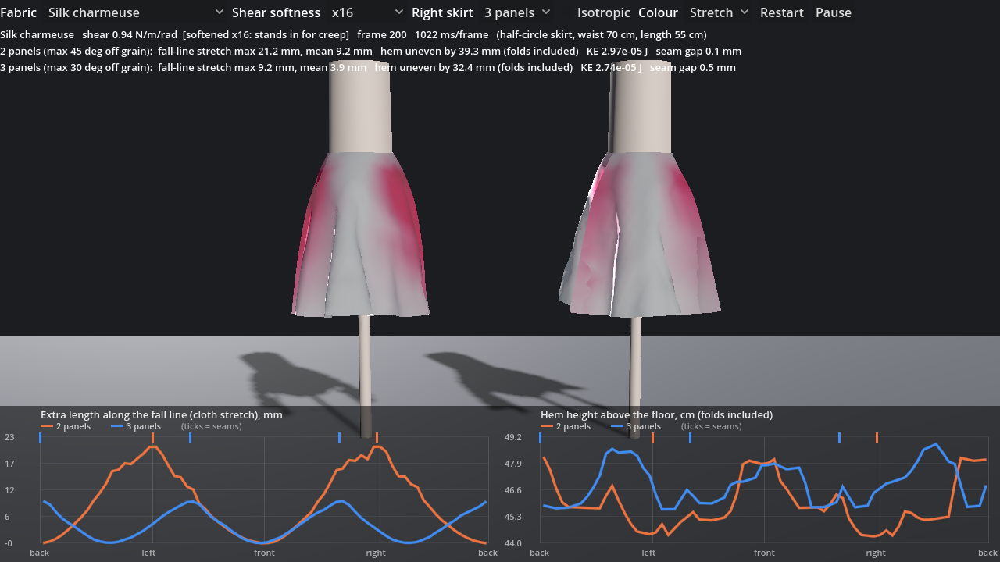

# Grain demo: why a flared skirt is cut from 3 panels rather than 2

`godot/bias_demo.tscn` (script `godot/bias_demo.gd`). Open it in the Godot editor and press F6. It is a standalone scene
and uses only the `FailoringSim` API, so the editor is not involved. It needs a library built from current main
(it calls `add_material`), so run `tools/build_gdext.sh` if the scene reports a missing method.

## Setup

Two half-circle skirts (flat flare = 180 deg; waist 70 cm, length 55 cm; 3 cm mesh, about 1170 vertices each) of the same
fabric, on identical dress forms. The forms are rotationally symmetric (ellipsoid hips plus a cylinder) and the waist
vertices are pinned. The warp runs down the centre line of every panel.

* Left: **2 panels**, each a 90 deg sector, so the cloth at the side seams hangs on true bias (45 deg off grain).
* Right: **3 panels** (front plus two back gores with a centre-back seam), each a 60 deg sector, so no cloth hangs more
  than 30 deg off grain. The toolbar can switch it to 4 or 6 panels.

Toolbar: fabric, shear softness (x1, x4, x16, x64), right-skirt panel count, isotropic control, colour (plain /
grain / live stretch), restart, pause. Keys: R restart, Space pause, C colour mode, I isotropic. Mouse: left-drag
orbits, right-drag pans, wheel zooms.

## What is measured

* **Fall-line stretch** (left graph): per triangle `|F d| - 1`, where `d` is the radial pattern direction (the line
  the cloth hangs along). It is area-weighted into 5 deg body-angle bins (15 deg window) and multiplied by the skirt
  length, which gives the extra length in mm. Folds are bending, not stretching, so they do not show up in it, and it
  isolates the grain.
* **Hem height** (right graph): what you would see on the skirt. Folds alone make it uneven by 25-37 mm, even with
  isotropic shear.

## Results (Godot 4.3 Linux headless, silk charmeuse, 240 frames, settled, KE ~1e-5 J)

| shear | 2 panels max / mean | 3 panels max / mean |
| --- | --- | --- |
| preset (15 N/m/rad) | 3.5 / 0.9 mm | 1.9 / 0.5 mm |
| softened x16 (0.94 N/m/rad, the scene's default) | 21-22 / 9.0 mm | 9-10 / 4.0 mm |
| isotropic control (G = sqrt(Ew Ef) / 2(1+0.3)) | 0.5 / 0.0 mm | 0.1 / 0.0 mm |

The stretch peaks at the seams and is zero at the panel centres. At x16 the 2-panel hem hangs 3-4 cm lower at the
sides than at front and back. In the isotropic control both skirts stretch by almost nothing, so the difference is
the grain and not the panel geometry.

## Limits

* The solver is linear-elastic per direction. Real bias drop is mostly creep while the garment hangs (hours to days),
  which this model lacks. At the preset shear the effect is only a few mm, below the fold noise in the hem. The
  softness factor stands in for the relaxed state and is **not calibrated** against real cloth.
* About 1 s per frame for both skirts on a 2-core container (they step in parallel on the WorkerThreadPool). Not timed on
  the Mac, and not run there or with Forward+; screenshots came from Xvfb with the compatibility renderer.
* Headless checks: `FL_BIAS_LOG=1 FL_FRAMES=240 [FL_SOFT=0..3] [FL_ISO=1] [FL_RIGHT=0..2] [FL_FABRIC=id]
  godot --headless --path godot res://bias_demo.tscn` prints `BIAS`, `CURVE` and `STRETCH` lines; `FL_SHOT=<png>`
  (with a real window) saves a screenshot.
