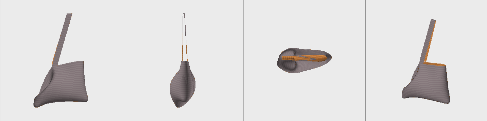
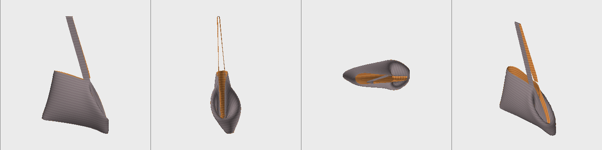
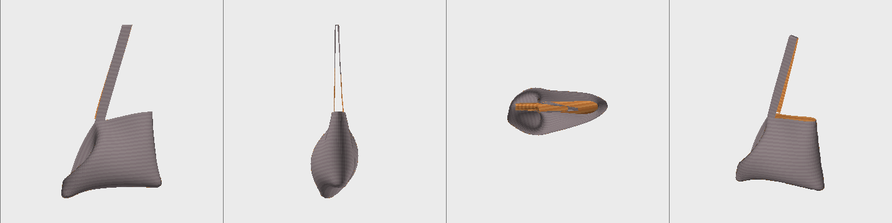
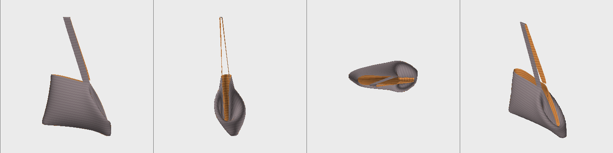
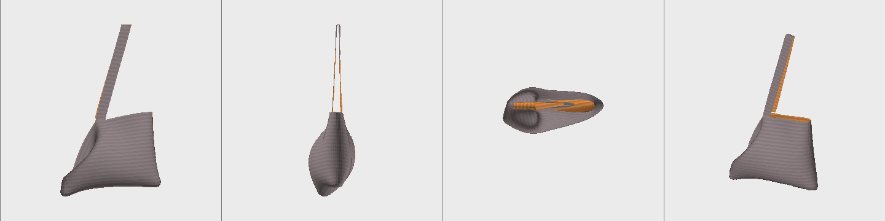

# T6.5 — Five-variant bag report (§11.2, user gate §14.9)

The five ways of working the round at the base of the laptop bag, each run through `crochet_cli` with the same settings: cotton worsted,
4.5 mm hook, `--scene auto` (hung by the strap), the MBA13 load. The pouch is the reference. Numbers come from `docs/crochet-shots/<name>.json`;
the table is `tools/crochet/variant_table.py`.

## The table

| piece | settled | corner angle (deg) | base sag (mm) | drop (cm) | bag height (cm) | gape (cm) | strap +% | load above rim (cm) | peak pressure (kPa) | mass (g) | frames |
|---|---|---|---|---|---|---|---|---|---|---|---|
| pouch (reference) | yes | - | - | 38.8 | 15.3 | 2.5 | 0.8 | 17.1 | 0 | 22 | 427 |
| plain sc round | yes | 170.9 | 13.8 | 51.5 | 23.8 | 9.2 | 9.0 | 7.9 | 132 | 106 | 2049 |
| BLO round | NO | 139.0 | 8.2 | 51.3 | 23.6 | 8.8 | 9.1 | 7.3 | 147 | 106 | 2193 |
| FLO round | yes | 169.8 | 13.2 | 51.4 | 23.7 | 9.2 | 9.0 | 7.8 | 129 | 106 | 2134 |
| sl st round | NO | 148.5 | 10.2 | 51.1 | 23.4 | 8.9 | 9.0 | 7.7 | 142 | 105 | 2190 |
| surface sl st | yes | 166.7 | 12.0 | 51.5 | 23.8 | 9.2 | 9.0 | 7.9 | 175 | 107 | 1941 |

## What the table says

* **Two groups.** Plain, FLO and surface sl st are close to each other: corner 166.7-170.9 deg, sag 12.0-13.8 mm. BLO (139.0 deg, sag 8.2 mm)
  and the sl st round (148.5 deg, sag 10.2 mm) are clearly apart from them, and apart from each other by 9.5 deg and 2.0 mm.
* **Everything else is the same to within about 1 cm or 1 g**: drop, bag height, gape, strap elongation, load height, mass. The five bags are the same
  size and weight and hang the same; only the shape of the corner at the base and the pressure on the load differ. If the question is "does the
  hinge choice change how big the bag is or whether the laptop fits", the answer here is no.
* **Peak pressure** is highest for the surface sl st (175 kPa against 132 for plain): the surface variant stiffens the faces above and below the
  edge (course x3, lock x0.5), probably the cause (not isolated). Plain, FLO, BLO and sl st lie between 129 and 147.
* **FLO is not distinguishable from plain** (1.1 deg, 0.5 mm, 3 kPa). In real life a FLO round and a plain round are told apart by the ridge on the
  inside and by how the corner sits. This is the one result that may mean a modelling problem, not a property of the stitch; see the questions below.

## What to trust

* **BLO and the sl st round did not settle.** The load phase stopped at the 1500-frame cap with `|F_net|` at 3.3 % (BLO) and 4.1 % (sl st) of the
  load's weight; the bar for settled is 2 %. Their final kinetic energy is 3.5e-06 J and 5.7e-07 J, against 2.5e-08 to 7.0e-08 J for the three that
  settled. The bag was still creeping, so the corner angle and the sag of these two are provisional; the direction (a sharper corner than plain) is
  not in doubt, the exact numbers are. A longer load run would settle this; it costs about 4-5 h of one core each.
* **The relaxation (zero gravity) is converged.** Plain and BLO, default relaxation against a 1200-frame relaxation: positions differ by at most
  0.08 mm, and the corner angles are identical (170.55 and 136.73 deg). So the corner angle difference between
  plain and BLO is not an artefact of stopping early. (Throwaway probes, not in the repo; the numbers are the angles of the relaxed shape, which
  is why they differ slightly from the loaded 170.9 and 139.0 above.) The pouch relaxation is the exception, noted in the T9.2 report.
* **Hinge settings are the plan's guesses** (§4.4: BLO 0.30 and +25 deg, FLO 0.35 and -25 deg, sl st round 1.50, surface 0.70), marked UNVERIFIED. Nothing here
  was fitted to a real bag. They become real when the hinge swatch of T9.2 is measured (a droop and a rest angle per construction).

## Snapshots

Loaded and hung, four views each (front, side, top, back). The orange is the strap and the rim, the grey the body.

**Plain sc round** — `docs/crochet-shots/bag_round_plain.png`

**BLO round** (not settled) — `docs/crochet-shots/bag_round_blo.png`

**FLO round** — `docs/crochet-shots/bag_round_flo.png`

**sl st round** (not settled) — `docs/crochet-shots/bag_round_slst.png`

**Surface sl st** — `docs/crochet-shots/bag_round_surface.png`

In the images plain, FLO and surface are alike: a rounded base and a wall that stands straight above it. BLO and the sl st round show a different
base corner and a creased wall on one side; the sl st round is between BLO and plain, as the numbers say. The relaxed
(unloaded) shapes are the `_rest.png` files next to these.

## Gate questions (asked of the user)

1. **Do the five variants look and measure plausibly different?** Two are (BLO, sl st round). Three are close (plain, FLO, surface). Whether FLO
   should sit so close to plain is for the user to say from what they have seen in real bags. One possible cause, not checked: the plan gives FLO
   a rest angle of -25 deg (toward the RS) and BLO +25 deg (toward the WS); for a bag worked in the round from the base up the RS is outside, so the
   BLO fold agrees with the direction the wall wants to turn and the FLO fold opposes it, and the load flattens it.
2. **Which "chain around the bottom" did they mean** (§11.3): a round of sl st (the `slst` variant), a surface sl st / chain along the base edge
   (`surface`), or a round of chains worked as stitches, e.g. `(sc, ch 1, sk 1) around` (a sixth variant, not built)?
