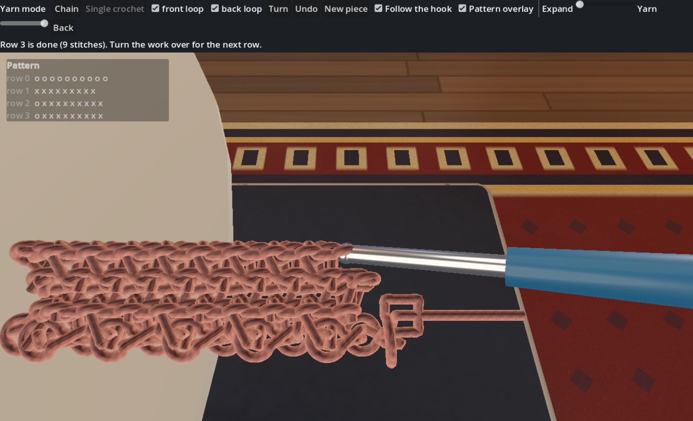
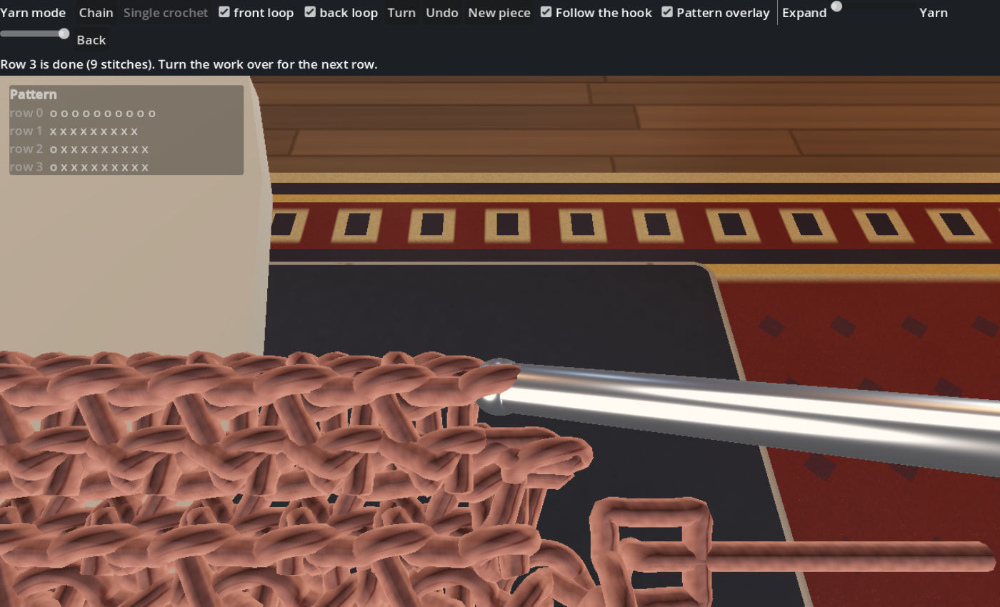
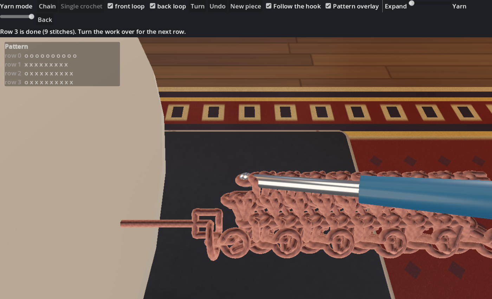
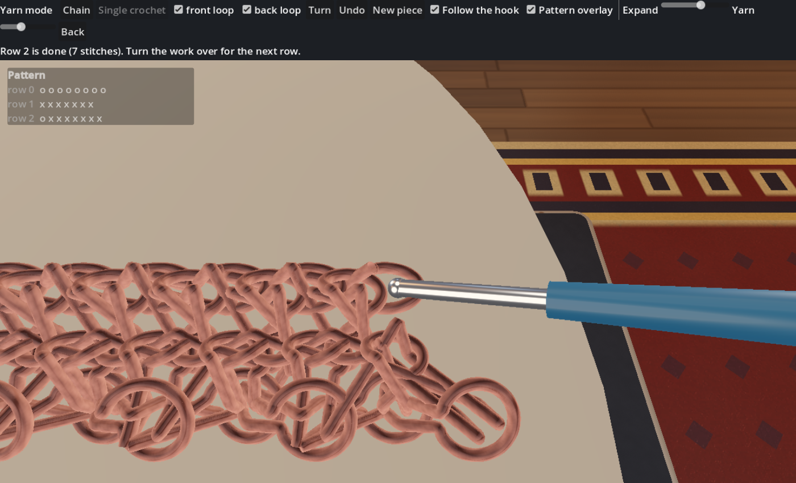
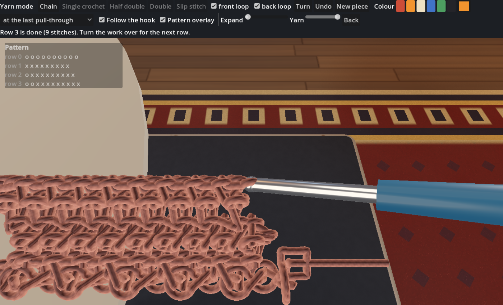
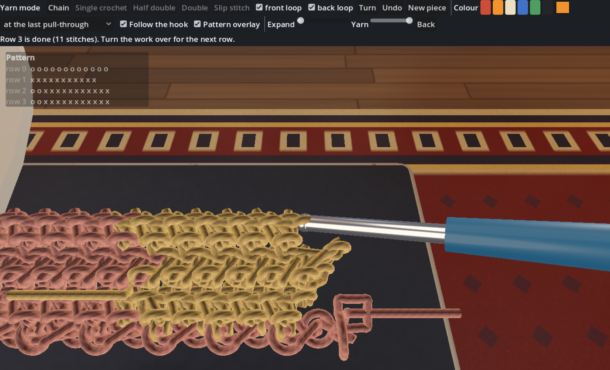
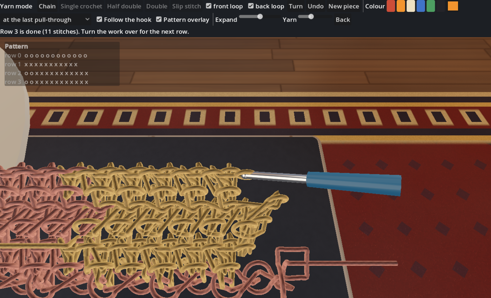

# Y2 — A chain and single crochet in yarn mode, and the first editor (docs/YARN_MODE_PLAN.md sections 7 and 11)

**GATE (plan section 7): the user looks at the sc swatch, close up, from front and back. Do the Vs look right?** Pictures below; they are the
real renderer, `FL_SHOT_YARN="ch10,turn,sc9,turn,sc9,turn,sc9" godot --path godot res://tests/crochet_shot.tscn` (see `crochet_shot.gd`).

| | |
|---|---|
|  |  |
| the swatch: a chain of 10, three rows of 9 sc, the hook at the live loop | close up (each stitch is a post topped by a bar) |
|  |  |
| the other side (as after turning the work over by hand) | expanded 2.2x with thin yarn: how the loops hook into each other |
|  |  |
| a row each of sc, hdc and dc above the chain | two colours, hdc, the colour changed at the seam in each row (the dropped yarn is picked up on the next row) |
|  | |
| the same, expanded and thin: where the two yarns meet | |

## What is there

* **The editor** (`godot/crochet/yarn_view.gd`, the "Yarn mode" button of the crochet editor), built to the brief of plan section 11:
  * One click per stitch with the choices made: **single crochet, half double, double, slip stitch** each go into the next stitch of the row below, under both
    loops. The hook moves to the opening, the yarn grows, the hook moves to the new loop. **Turn** flips the piece about its own vertical axis with a lift (the
    worker sees the other side; camera and hook stay); the turning chain follows the last stitch made (sc 1, hdc 2, dc 3).
  * Clicking a loop picks it as the opening instead. **front loop / back loop** ticks (both ticked by default; untick one to work into the other only, untick
    both to skip the stitch). **Shift + click** marks a loop that the next stitch's last pull-through takes as well (a seam can be joined several ways).
  * **Colours**: swatches and a picker; the next stitch changes to the chosen colour at its last pull-through (the usual way: its top is the new colour) or from
    the start of the stitch; a colour used before is picked up again where it was dropped, a new one starts a yarn with a tail by the hook.
  * A semi-transparent **pattern overlay** (o + T dagger dot dash in the yarn's colour), a **Pattern...** panel (type or paste a pattern, **Build now** or **Play**
    it stitch by stitch; **Show mine** writes out what you have made: the text round-trips, colours included), Undo (replay), New piece.
  * **Expand** and **Yarn** sliders open the loops up and thin the yarn so you can see through the interlocking. **Ctrl + drag** takes hold of a strand: the yarn near it
    follows softly (2.8, 1.6, 0.5 mm at 1, 3, 6 nodes along for a 4 mm pull) and springs back when let go.
* **The yarn** (`YarnWork`, `crochet_core`): the design is a polyline per yarn (a *strand*); the rod system is rebuilt from the strands after every action and is only
  the soft layer (a shape memory spring, strand contact, a pseudo-mass so that the springs are soft at an interactive step). A stitch is a **post** (the loop pulled
  up through the stitch below: two legs through its eye) topped by a **bar** (the loop pulled through that and the loops on the hook: a flat elongated ring leaning
  back toward the worker). The bars are the stitch's front loop and back loop. hdc and dc add yarn overs (rings on the hook behind the post) and pull through three,
  or two and two.
* **Plies drawn as helices** that follow the rod's material frame (`yarn_render`), shaded.

## How it was made, and what did not work (so nobody repeats it)

Building the topology by physics (fingers made roomy round a hook, tightened by tension and by shrinking rest lengths) gave blobs; see plan section 12. What
worked: place every loop on an explicit lattice position, run the legs through the eye of the loop pulled through at the lattice's angle, build it tight, and
**check it**. A real photograph of an sc swatch (Wikimedia Commons, "Single crochet swatch.jpg"; looked at, not copied) showed what to aim at: a short vertical
post of two strands under a horizontal slanted bar, with a dark gap between stitches; the first design (round rings facing the viewer) was wrong, bars are right.
`yarn_tune` then searches the lattice parameters (stitch width and height, ring and bar sizes, tilt, leg gap, approach) for a design in which every pass through
an eye threads cleanly and no strands overlap more than worsted can squeeze (to half a diameter): **25 of 26 passes thread cleanly** in the tuned design.

## Checks

* `test_crochet_rod` (new test: a meander with 90 degree corners stays put; with the small-angle Jacobian the stretch went to 330 %).
* `test_crochet_yarn_work`: the cursor and the pattern text; at least 90 % of the passes through eyes are clean threadings (34 of 37); every post goes through
  the eye of its stitch with both legs; under one loop only the legs straddle that strand (one piercing instead of two; mutant: the mode ignored -> 2 failures);
  the same actions give the same yarn bit for bit.
* `test_crochet_yarn_work` also: hdc / dc / sl st rows stand at their heights and every pass threads its eye; colour changes (a new yarn, the post in the old colour and
  the top in the new, a yarn picked up again where it was dropped, the whole stitch in the new colour); an extra loop in the last pull-through (mutant: ignored -> fails);
  the soft pull (mutant: pseudo-mass 1 -> the neighbours stay put).
* `yarn_view_check` (headless, 50 checks): one click per stitch, cursor, turning (the turning chain follows the stitch), undo, picking a loop, the loop ticks and skip,
  hdc / dc / sl st, colours (pending, two yarns, picked up again, undo), the overlay in colour, Shift + click extras, the pattern text both ways, expand and thin yarn,
  grab / pull / let go.

## What is not right, or not verified

* **The geometry is designed, not simulated**, and judged by eye against one photograph. It will be wrong in ways a crocheter sees at once; the gate exists for that.
  The relationship between the rows' lean and the worker's side after a turn is a guess (all bars lean toward +z in the design; the view flips the piece).
* **Front-loop and back-loop only** are modelled as "the legs straddle that strand": UNVERIFIED against real work. The model has no ridge geometry for the unworked loop yet.
* The strands overlap where the design squeezes them (about 100 mm^2 of overlap at half width, summed over the swatch); the contact (radius scale 0.55) lets them
  push apart a little. Nothing resolves the leftover near-contacts at the slip knot.
* **Soft is minimal**: the anchor spring returns the work to its design; nothing yet lets the user drag the yarn. The soft physics costs about 50 ms per step at 4000
  particles (too slow to run every frame for large pieces; Y6).
* Not yet: foundation sc, post stitches, between-stitch openings, increases and decreases (more than one stitch into an opening, one stitch into more than one), puff / bobble.
* The hdc, dc and sl st parameters (heights, where the yarn overs lie) were found by `yarn_tune` with the sc design held fixed; the dc and sl st rows still have legs that wiggle through
  an eye more than once (every pass does go through its eye). They have not been compared with a photograph of real hdc / dc. The yarn's torsion shows only as the ply helix following
  the frame (no lean of the stitches yet). The hook's motion is cosmetic.
